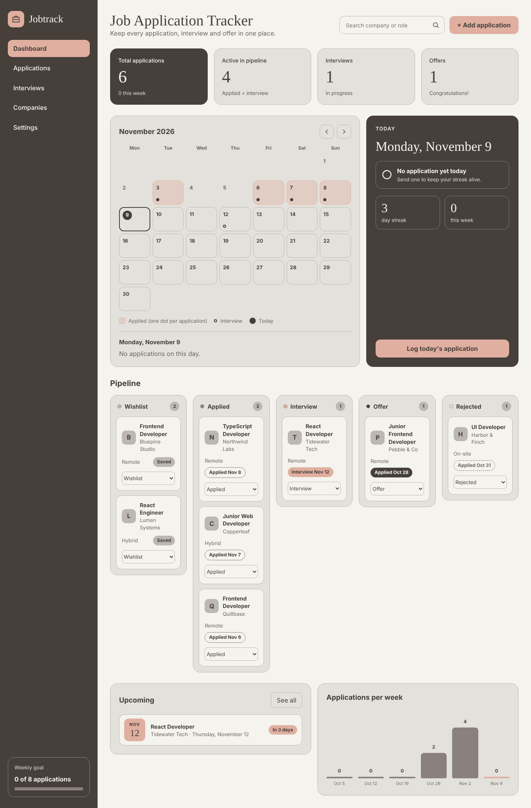
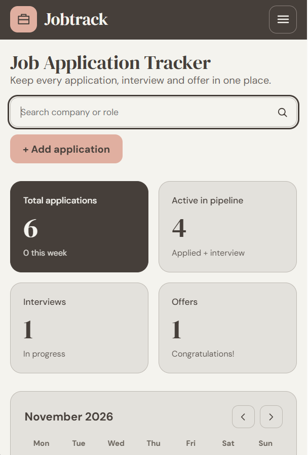
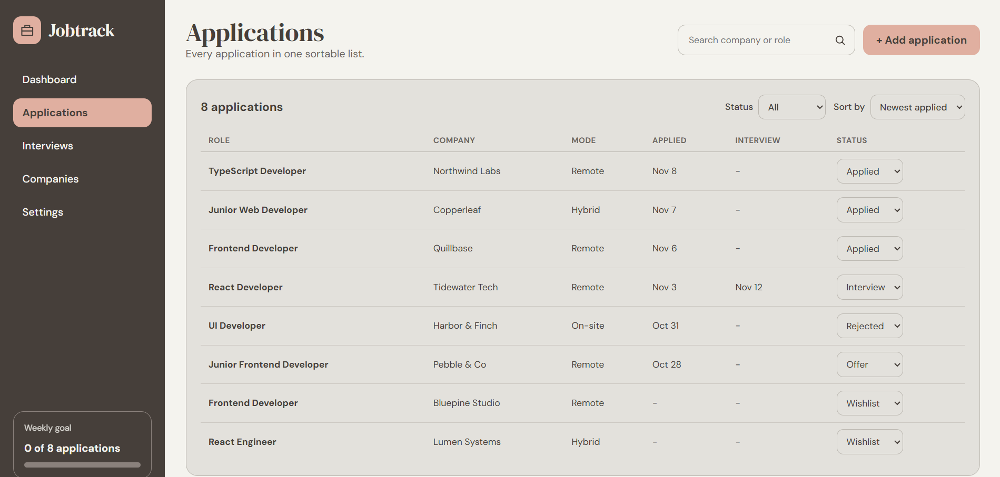

# JobTrack – Job Application Tracker

A responsive job application tracker built with **React, TypeScript, and Vite**.

JobTrack helps you organize your job search, track applications through a Kanban board, manage interviews, monitor your weekly progress, and keep everything in one place.

## 🚀 Live Demo

**[View JobTrack Live Demo](https://job-tracker-one-lime.vercel.app/)**

## 📸 Screenshots

### Dashboard – Desktop



### Dashboard – Mobile



### Applications View



## ✨ Features

- **Five Pages:** Dashboard, Applications (sortable and filterable table), Interviews (upcoming and past), Companies (grouped by company), and Settings.
- **Kanban Board:** Manage applications across five statuses: Wishlist, Applied, Interview, Offer, and Rejected. Supports drag and drop or status selection.
- **Monthly Calendar:** View application and interview activity throughout the month.
- **Today's Progress:** Track daily applications, application streaks, and weekly progress.
- **Application Management:** Add, edit, delete, and search applications by company or role.
- **Local Storage:** Automatically saves application data using `localStorage` (no backend required).
- **Two Themes:** Switch between Neutral Elegance and Warm Sand.
- **Data Management:** Export and import application data as JSON, set weekly goals, and clear all data.
- **Responsive Design:** Optimized for desktop, tablet, and mobile screens.
- **Accessibility:** Keyboard-accessible interface and controls.

## 🛠️ Tech Stack

- React
- TypeScript
- Vite
- CSS
- Browser Local Storage

## 💡 TypeScript Highlights

- Union types derived from a const array: `type Status = (typeof STATUSES)[number]`
- Discriminated union actions with an exhaustive `useReducer` reducer (`src/state/applications.ts`)
- Generic custom hook `useLocalStorage<T>` with a type guard for stored data
- Generic typed form setter `set<K extends keyof FormState>(key: K, value: FormState[K])`
- Strict type checking with `strict` and `noUncheckedIndexedAccess` enabled
- No `any` types

## ⚙️ Installation & Setup

Clone the repository:

```bash
git clone YOUR_GITHUB_REPOSITORY_URL
```

Navigate to the project directory:

```bash
cd job-tracker
```

Install dependencies:

```bash
npm install
```

Start the development server:

```bash
npm run dev
```

Build for production:

```bash
npm run build
```

## 📁 Project Structure

```text
src/
├── types.ts
├── state/
│   └── applications.ts
├── hooks/
│   └── useLocalStorage.ts
├── lib/
│   ├── date.ts
│   ├── stats.ts
│   └── storage.ts
└── components/
    ├── Sidebar.tsx
    ├── StatCards.tsx
    ├── Calendar.tsx
    ├── TodayCard.tsx
    ├── Board.tsx
    ├── ApplicationCard.tsx
    ├── ApplicationForm.tsx
    ├── ApplicationsView.tsx
    ├── InterviewsView.tsx
    ├── CompaniesView.tsx
    └── SettingsView.tsx

screenshots/
├── dashboard-desktop.png
├── dashboard-mobile.png
└── applications.png
```

## 👩‍💻 Author

**Marzieh Feyz**

[GitHub](https://github.com/marziehfezydev)

---

Built with ❤️ to make the job search process more organized.
