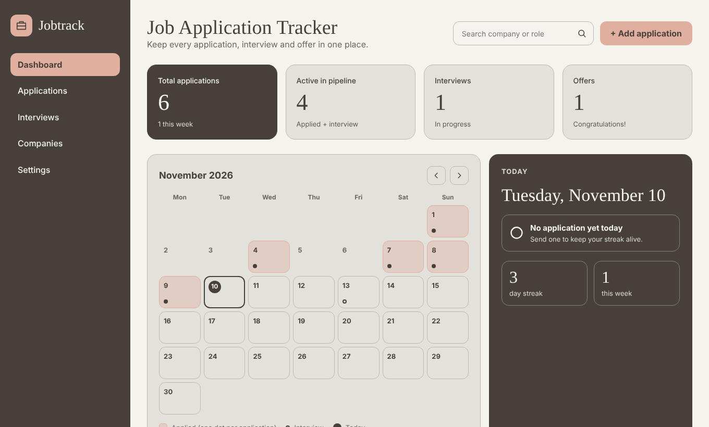

# JobTrack – Job Application Tracker

A responsive job application tracker built with **React, TypeScript, and Vite**.

JobTrack helps you organize your job search: track applications on a Kanban board, see what you sent each day on a calendar, manage interviews, and follow your weekly progress, all in one place.

## 🚀 Live Demo

**[View JobTrack Live Demo](https://job-tracker-one-lime.vercel.app/)**

The first launch shows fictional sample data. Use **Settings → Clear all applications** to start with your own.

<p align="center">
  
</p>

## ✨ Features

- **Five pages:** Dashboard, Applications (sortable and filterable table), Interviews (upcoming and past), Companies (grouped by company), and Settings.
- **Kanban board:** Five statuses: Wishlist, Applied, Interview, Offer, and Rejected. Drag and drop, or change the status with the select on each card.
- **Monthly calendar:** See the day of every application and interview.
- **Today's progress:** Did you apply today? Daily streak, weekly count, and a weekly goal.
- **Upcoming list and weekly chart:** The next interviews and applications sent per week.
- **Manage applications:** Add, edit, and delete applications. Click an application's title to open its form.
- **Search:** Filters by company or role while you type. Press Enter to save the search as a label and start a new one.
- **Local storage:** Data is saved in your browser with `localStorage` (no backend needed).
- **Two themes:** Neutral Elegance and Warm Sand.
- **Data management:** Export and import your data as JSON.
- **Responsive design:** On small screens the sidebar collapses into a menu.
- **Accessibility:** Keyboard-accessible controls with labels for screen readers.

## 🛠️ Tech Stack

- React
- TypeScript
- Vite
- CSS (custom properties for theming)
- Browser Local Storage

## 💡 TypeScript Highlights

- Union types derived from a const array: `type Status = (typeof STATUSES)[number]`
- Discriminated union actions with an exhaustive `useReducer` reducer (`src/state/applications.ts`)
- Generic custom hook `useLocalStorage<T>` with a type guard for stored data
- Generic typed form setter `set<K extends keyof FormState>(key: K, value: FormState[K])`
- `Record<SortKey, ...>` comparator map: adding a sort option without a comparator is a compile error
- Strict type checking with `strict` and `noUncheckedIndexedAccess` enabled
- No `any` types

## ⚙️ Installation & Setup

Clone the repository:

```bash
git clone https://github.com/marziehfezydev/job-tracker.git
```

Go to the project folder:

```bash
cd job-tracker
```

Install dependencies:

```bash
npm install
```

Start the development server:

```bash
npm run dev
```

Build for production (type-checks first):

```bash
npm run build
```

## 📁 Project Structure

```text
src/
├── types.ts
├── state/
│   └── applications.ts
├── hooks/
│   └── useLocalStorage.ts
├── lib/
│   ├── date.ts
│   ├── stats.ts
│   └── storage.ts
└── components/
    ├── Sidebar.tsx
    ├── StatCards.tsx
    ├── Calendar.tsx
    ├── TodayCard.tsx
    ├── Board.tsx
    ├── ApplicationCard.tsx
    ├── ApplicationForm.tsx
    ├── UpcomingCard.tsx
    ├── WeeklyChart.tsx
    ├── ApplicationsView.tsx
    ├── InterviewsView.tsx
    ├── CompaniesView.tsx
    └── SettingsView.tsx
```

## 👩‍💻 Author

**Marzieh Feyz**

[GitHub](https://github.com/marziehfezydev)
